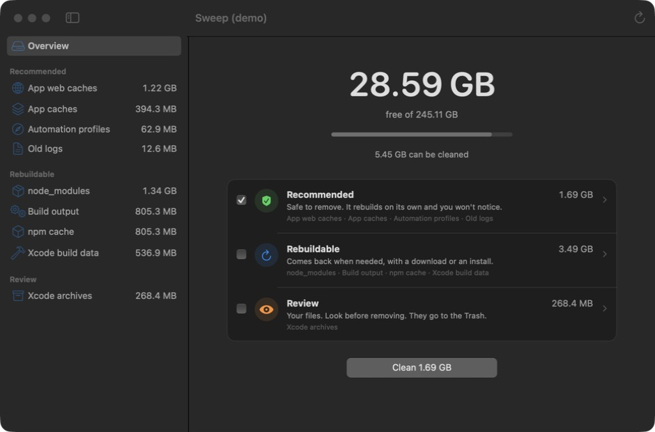

<p align="center">
  
</p>

<h1 align="center">Sweep</h1>

<p align="center">
  A small, native Mac app that frees disk space safely,<br>
  and tells you exactly what it removes and why.
</p>

<p align="center">
  <a href="https://github.com/Arul-Raaj/sweep/releases/latest"><b>Download for Mac</b></a> ·
  macOS 14 or later · Apple silicon and Intel · Free and open source (MIT)
</p>

<p align="center">
  
</p>

## Why Sweep

On a Mac with a small drive, the "Your disk is almost full" warning keeps coming back.
Most of that space is files that rebuild themselves: app caches, package caches, old
logs, and the `node_modules` and build folders of projects you haven't opened in weeks.

Sweep finds them, sorts them by how safe they are to remove, explains each one in plain
words, and lets you decide. It's about 1 MB, has no dependencies, never connects to the
internet, and never touches your documents.

## Download and install

1. Download **Sweep-x.y.z.dmg** from the [latest release](https://github.com/Arul-Raaj/sweep/releases/latest).
2. Open it and drag **Sweep** into **Applications**.
3. Open Sweep. The first time, macOS will say it can't verify the developer. That's
   because Sweep isn't notarized by Apple yet (that needs a paid Apple Developer
   account). To open it anyway:
   - **macOS 15 and later:** open **System Settings → Privacy & Security**, scroll down,
     and click **Open Anyway** next to the message about Sweep.
   - **macOS 14:** right-click Sweep in Applications and choose **Open**.

   Or, in Terminal: `xattr -dr com.apple.quarantine /Applications/Sweep.app`

   You only do this once. If you'd rather not run a downloaded app, [build it yourself](#build-from-source)
   in a minute.
4. macOS asks once each whether Sweep may read your **Desktop**, **Documents** and
   **Downloads** folders (that's where project folders and old installers live). See
   [Permissions](#permissions).

## How it works

Sweep scans when you open it (about 15 seconds) and sorts what it finds into three levels:

| Level | What it means | Selected for you | How it's removed |
|---|---|---|---|
| **Recommended** | Rebuilds on its own. You won't notice it's gone. | Yes | Deleted |
| **Rebuildable** | Comes back, but costs a download, an install or a rebuild. | No | Deleted |
| **Review** | Your own files. Only you can judge. | No | Moved to the Trash |

Press **Clean** (⌘⌫) to remove what's selected. Click any level or category to see every
item with its size, full path and last-used date, untick anything, or show it in Finder.
Every category explains three things: what the files are, why removing them is safe,
and what you'll notice afterwards.

When it's done you hear the familiar Finder empty-trash sound (it follows your "Play user
interface sound effects" setting) and see how much space came back.

## What it finds

| Level | Category | Where | Listed when |
|---|---|---|---|
| Recommended | App web caches | Cache folders of apps built on web technology (Slack, Teams, Notion, Figma, Discord, Claude…) | The app is closed and hasn't used them for an hour |
| Recommended | App caches | `~/Library/Caches` | Untouched for 3 days |
| Recommended | Automation profiles | Browser profiles left by Puppeteer, Playwright and AI browser agents in your temporary folder | Untouched for a day |
| Recommended | iPhone & iPad updates | `~/Library/iTunes/*Software Updates` | Always |
| Recommended | Simulator caches | `~/Library/Developer/CoreSimulator/Caches` | Always |
| Recommended | Old logs | `~/Library/Logs` | Older than 7 days |
| Recommended | Old Trash | `~/.Trash` | Trashed more than 30 days ago |
| Rebuildable | node_modules | Projects in `~/Desktop`, `~/Documents`, `~/dev`, `~/Developer`, `~/Projects`, `~/code` | No activity in the project for 14 days |
| Rebuildable | Build output | `.next`, `.turbo`, `.nuxt`, `.svelte-kit`, `.parcel-cache`, `.angular` in those projects | No activity for 14 days |
| Rebuildable | npm and Bun caches | `~/.npm/_cacache`, `~/.bun/install/cache` | Always |
| Rebuildable | Claude Cowork sandbox | The VM Claude's desktop app uses for Cowork | Only removable while Claude is closed |
| Rebuildable | Xcode build data | `~/Library/Developer/Xcode/DerivedData` | Always |
| Rebuildable | Xcode device support | `~/Library/Developer/Xcode/*DeviceSupport` | Unused for 30 days |
| Review | Old installers & archives | `.dmg`, `.pkg`, `.zip`, `.iso`… in `~/Downloads` | In Downloads for 60 days |
| Review | Xcode archives | `~/Library/Developer/Xcode/Archives` | Older than 90 days |
| Review | iPhone & iPad backups | `~/Library/Application Support/MobileSync/Backup` | Always listed, never selected for you |

### What Sweep never touches

- Your documents, photos, source code, and folders you organise yourself (even inside Downloads).
- `package.json`, lockfiles, `dist` and `build` folders.
- App settings, sign-ins, local storage and offline data (service-worker caches included).
- Apple's own system caches, and "caches" that really hold data: local AI model weights,
  Python environments, test browsers, Spotify's offline music.
- Anything outside your home folder, except stale automation profiles directly inside
  your temporary folder.
- Anything an open app is using.

## How it stays safe

- **Scanning only reads.** Nothing is removed until you press Clean and confirm.
- **Every item is checked again right before it's removed,** independently of the scan:
  1. **Location:** it must sit directly inside its category's folder (or be a real
     `node_modules`/build folder next to a `package.json`, or a verified browser cache),
     at least two levels inside your home folder, with an allowed name and file type.
  2. **Still unused:** its age is checked again. Anything changed since the scan, or
     written to in the last two minutes (a build, a backup in progress), is kept.
- **Open apps are detected three ways:** an app with that name is running, any file is
  open inside the app's folder, or the cache was used in the last hour. Any one of them
  locks the row and says why ("Claude is open. Quit it to clean this.").
- **Browser caches are verified, not guessed.** A folder only counts if it has Chromium's
  own cache layout inside a real Chromium profile, so a random folder named "Cache" is ignored.
- **"Unused project" errs towards active.** Any file change, git activity (worktrees
  included) or install counts; a project too large to check fully counts as active.
- **Symlinks are removed, never followed.**
- **One clean at a time,** and failures are skipped and logged, never fatal.

The [research behind these rules](docs/research.md) covers what fills Macs with small
drives, what's safe to remove, and the widely shared advice that isn't.

## Permissions

Sweep needs no special permissions to start. macOS asks once each for **Desktop**,
**Documents** and **Downloads**, where it looks for projects and old installers.

**Full Disk Access** (System Settings → Privacy & Security → Full Disk Access → add Sweep)
is optional. It lets Sweep also see:

- **Old Trash** (macOS protects `~/.Trash`),
- **iPhone & iPad backups**,
- **sandboxed apps' caches**, such as Microsoft Teams.

Without it those rows show a lock or don't appear, and everything else works.

## Command line

The app includes a `sweep` command (`./build.sh install` links it into `~/.local/bin`):

```bash
sweep scan -v            # list everything by level (removes nothing)
sweep clean              # remove Recommended items only
sweep clean --level 2    # Recommended and Rebuildable
sweep schedule on        # clean Recommended items every Monday at 11:00
sweep schedule off
sweep --version
```

The weekly clean is off by default, can also be switched in Settings (⌘,), and only ever
removes Recommended items. Rebuildable and Review always wait for you.

## Try it without touching your files

Sweep can run against a fake home folder full of realistic junk, which is handy for a
first look, for screenshots and for development:

```bash
tools/make-demo-home.sh /tmp/sweep-demo
SWEEP_HOME=/tmp/sweep-demo build/Sweep.app/Contents/MacOS/Sweep
```

With `SWEEP_HOME` set, Sweep looks only inside that folder, temporary files included.
The demo uses APFS clones, so its several "gigabytes" take about 300 MB of real space.

## Build from source

You need macOS 14 or later and Swift 6. The free Command Line Tools are enough; Xcode is optional.

```bash
xcode-select --install      # only if you don't have Swift yet
git clone https://github.com/Arul-Raaj/sweep.git
cd sweep
./build.sh install          # build, copy to ~/Applications, link `sweep`, open
```

Other build commands:

```bash
./build.sh                  # build build/Sweep.app only
./build.sh release          # universal app, packaged as build/Sweep-<version>.dmg and .zip
./test.sh                   # run the tests
```

**Signing:** `build.sh` signs with `$SWEEP_SIGN_IDENTITY`, or with an "Apple Development"
or "Sweep Local" certificate if you have one, so macOS remembers folder permissions
across builds. Otherwise it signs ad hoc, and macOS asks for folder access again after
each rebuild.

## Uninstall

1. If you turned on the weekly clean: `sweep schedule off` (or switch it off in Settings).
2. Drag Sweep from Applications to the Trash.
3. Optionally remove `~/Library/Logs/Sweep.log`, `~/Library/Application Support/Sweep`
   and `~/.local/bin/sweep`.

## FAQ

**Does Sweep send anything anywhere?** No. It has no network code at all.

**Why isn't it on the App Store?** The App Store requires a sandbox, and a sandboxed app
can't see other apps' caches or your project folders. That's the whole job.

**Why does macOS warn that it can't verify the developer?** Sweep isn't notarized yet.
The code is all here, and you can build it yourself with one command.

**Can it delete something important?** It's built so it can't: every rule is a narrow,
documented location with its own safety check, items are re-checked right before
removal, open apps are skipped, and your own files only ever go to the Trash. If you
find a case where it's wrong, please [open an issue](https://github.com/Arul-Raaj/sweep/issues).

**Why isn't X cleaned?** Some large items are left alone on purpose because they hold
state, not cache: app backups, conversation history, updaters, VM disks of running apps.
Others, like Apple Intelligence models or Time Machine snapshots, should only be removed
through Apple's own settings and tools. The [research](docs/research.md) explains each one.

## Project layout

```
Sources/
  SweepCore/                  the engine (no UI, fully tested)
    Rule.swift                levels, categories, and the explanations shown in the app
    Sweeper.swift             scanning (in parallel), cleaning, delete-time re-checks
    Sweeper+Projects.swift    unused-project detection for node_modules and build output
    Sweeper+WebCaches.swift   Chromium cache detection
    Safety.swift              the location check every item passes before removal
    OpenFiles.swift           which files are open right now (lsof)
    RunningApps.swift         is an app with this name running?
    Paths.swift               your home folder, or SWEEP_HOME
    System.swift              disk space, log, lock, weekly schedule
  Sweep/                      the app and the `sweep` command
    SweepApp.swift            window, Settings, app delegate
    Model.swift               state, selection, scan and clean actions
    Views/                    Overview, Sidebar, CategoryView, Components, ItemLabel, Settings
    Feedback.swift            empty-trash sound and trackpad haptics
    CLI.swift                 the `sweep` command
Tests/                        Swift Testing suite, including an end-to-end run on a fake home
App/                          Info.plist and icon
tools/                        icon generator and demo-home builder
docs/                         screenshot, icon, research
```

## Contributing

Bug reports, ideas and pull requests are welcome. See [CONTRIBUTING.md](CONTRIBUTING.md),
especially the bar for adding a new cleaning rule.

## License

[MIT](LICENSE)
